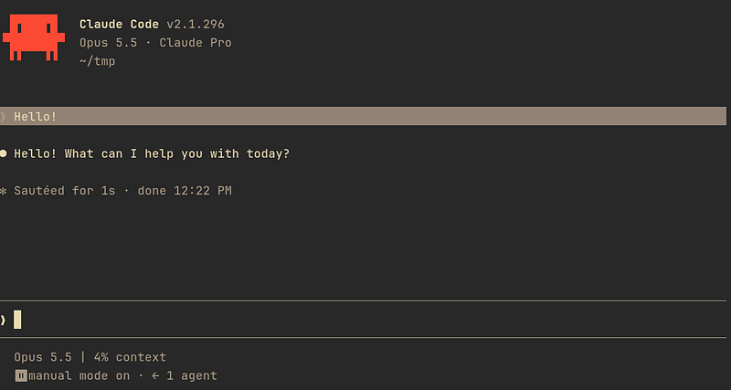
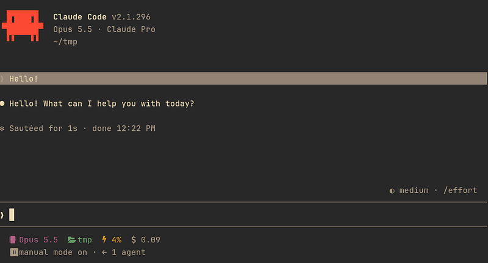
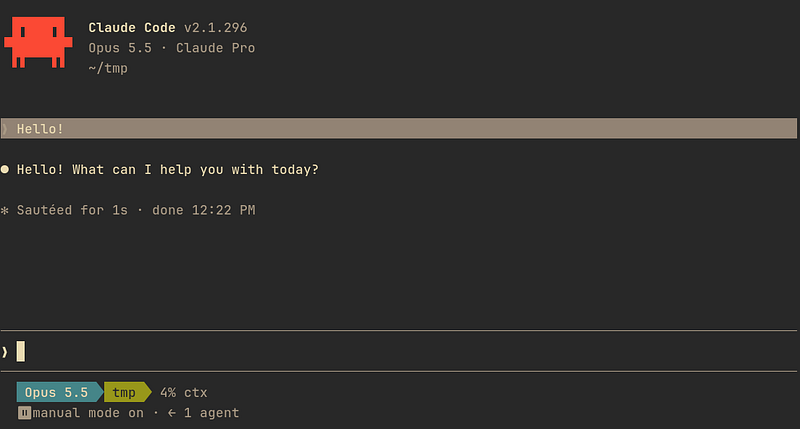
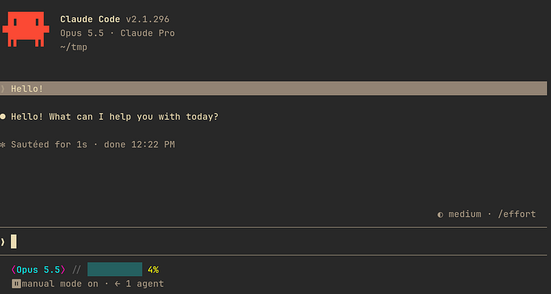
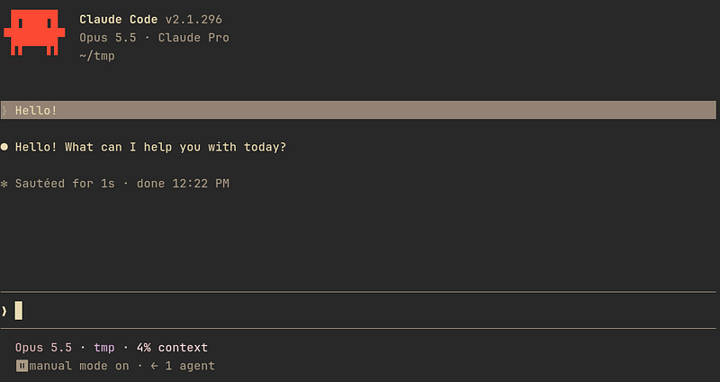
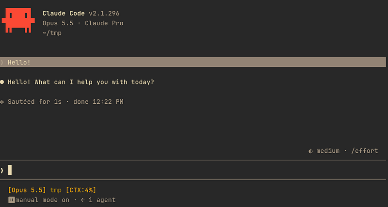
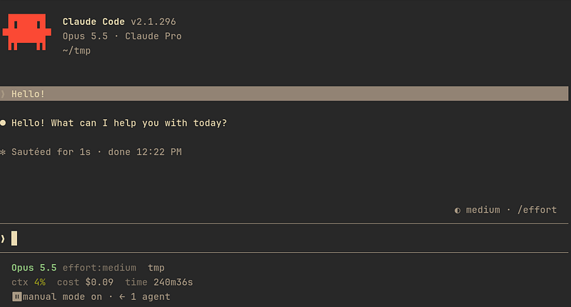
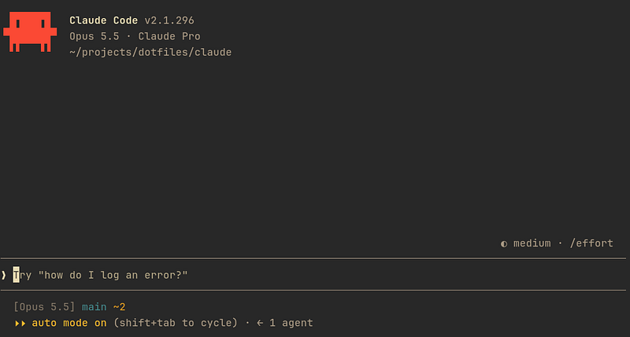
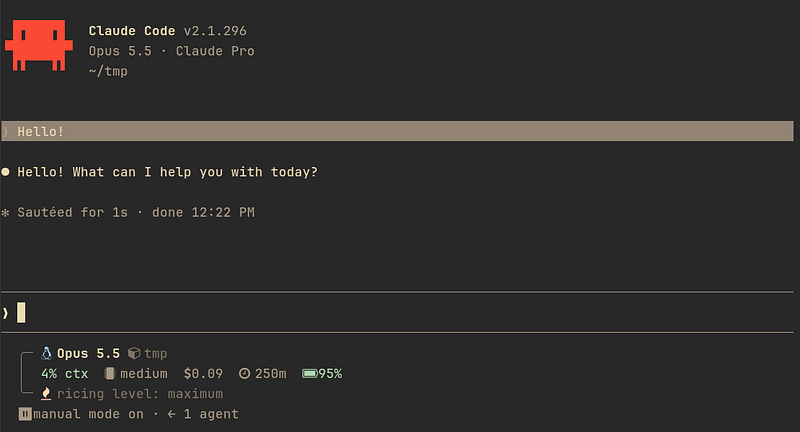

# Claude Code statusline examples

Ten self-contained bash scripts showing different directions you can take
a Claude Code status line, from bare-minimum to full unixporn. All of them
read JSON from stdin, exactly the way Claude Code feeds a real `statusLine`
command — see [the docs](https://code.claude.com/docs/en/statusline).

| Script                      | Style                                                                                                                      |
| --------------------------- | -------------------------------------------------------------------------------------------------------------------------- |
| `01-minimal.sh`             | Model + context %. No colors, no icons. The baseline.                                                                      |
| `02-nerdfont-icons.sh`      | A [Nerd Font](https://www.nerdfonts.com/) glyph in front of every segment. Needs a Nerd Font installed.                    |
| `03-powerline.sh`           | Classic Powerline color-block segments joined by arrow glyphs. Needs a Powerline/Nerd Font.                                |
| `04-cyberpunk.sh`           | Neon magenta/cyan truecolor, glitch brackets, a block-glyph context bar.                                                   |
| `05-elegant-pastel.sh`      | Soft dusty-rose/lavender/sage truecolor palette, thin dot separators, no brackets.                                         |
| `06-retro-terminal.sh`      | Monochrome amber CRT look, square brackets, no icons.                                                                      |
| `07-dashboard-verbose.sh`   | Multi-line. Shows model, effort, directory, git branch, context %, cost, duration, and both rate-limit windows.            |
| `08-git-focused.sh`         | Branch, staged/modified counts, and an open-PR badge if one exists.                                                        |
| `09-unixporn-maximalist.sh` | Boxed widget, Nerd Font icons for everything, a real battery reading pulled from `/sys/class/power_supply`, one flex line. |
| `10-playful-cat.sh`         | A kaomoji cat whose mood changes with context usage — purring at low %, side-eyeing you as it climbs, dead at 85%+.        |

## Screenshots

### `01-minimal.sh`



### `02-nerdfont-icons.sh`



### `03-powerline.sh`



### `04-cyberpunk.sh`



### `05-elegant-pastel.sh`



### `06-retro-terminal.sh`



### `07-dashboard-verbose.sh`



### `08-git-focused.sh`



### `09-unixporn-maximalist.sh`



### `10-playful-cat.sh`


## Try one

```bash
chmod +x 01-minimal.sh
echo '{"model":{"display_name":"Opus"},"workspace":{"current_dir":"/home/you/project"},"context_window":{"used_percentage":42}}' | ./01-minimal.sh
```

## Use one for real

Point `statusLine.command` at the script in `~/.claude/settings.json`:

```json
{
    "statusLine": {
        "type": "command",
        "command": "bash /path/to/01-minimal.sh"
    }
}
```

Requires `jq`. The icon/powerline scripts also require a patched
[Nerd Font](https://www.nerdfonts.com/) in your terminal, or the glyphs
render as boxes or question marks. The color scripts assume a 24-bit
truecolor terminal, which is the default on most modern emulators.

---

Made with the help of [Claude Code](https://claude.com/claude-code).
